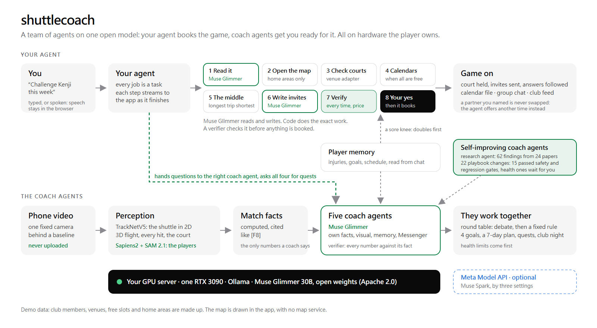

# Serve

**Play more. Manage less.**

Serve is a sports club app with an agent that gets you playing. It lines up your games with the people you play best
with, agrees them with their agents, plans around your body and your health app, finds a court in any ball sport, and
cuts your highlight for Instagram. You just say yes. Every agent runs on **Muse Glimmer**, Meta's open-weights model,
on a GPU we own; Meta's **Sapiens2**, **SAM 2.1** and **DETR** read the video.

Meta Global AI Developer Hackathon 2026 · Indie Developer track · Build for Your World



## Impact: playing takes organizing, so people stop

31% of adults worldwide did not get enough physical activity in 2022 (World Health Organization, 2024). Most people
who stop playing a sport don't stop liking it; they stop organizing it.

| The pain | What Serve does |
|---|---|
| **Playing takes organizing.** A time that suits four people, a free court, somewhere everyone can reach. The group chat goes quiet. | **Autopilot** lines up the week and agrees every game with the other players' agents. You approve once, in the app or with a tap in Messenger. |
| **Nobody pushes you.** One missed week becomes a month. Apps count steps; none books your next game. | It learns when you usually play and who you play best with (games that run past their booking), nudges you before your usual time and runs your week every Monday. |
| **Life gets in the way.** A sore knee, a heavy week, rain on an outdoor court. | **Body log and health app:** tell it what hurts and share your health export; it plans doubles, shorter games or one game fewer, checks in two days later, and says when to see a physio. **Courts near you:** it checks the map, the reviews and the forecast. |
| **Playing is better together.** | A club with a leaderboard, challenges, a random match and your best match; a highlight reel of you, in any ball sport. |

It is for anyone who plays a ball sport for fun, and the clubs and friends they play with: badminton, tennis,
pickleball, table tennis, basketball, volleyball, soccer. Your video and your health data stay on your own server.

## What the agent does

- **Autopilot** (`agent/src/autopilot.js`, `#/autopilot`). Against a weekly goal, Muse Glimmer runs the week as a
  tool-using agent: `get_week`, `check_body`, `find_partners`, `find_places`, `negotiate`, `request_approval`,
  `nudge`, `finish`. Code runs every tool with checked arguments and returns the facts; the model picks the next step
  and says why. A step budget, and rules finish the plan if the model stalls. Nothing is booked without your yes.
- **Agent to agent** (`agent/src/a2a.js`). Your agent proposes a time; every member's agent (Muse Glimmer, from what
  that member shares) answers at the same time: accept, counter or decline. Counters are checked by code against
  everyone's calendar and the court timetable; your agent moves to the time most of them asked for, up to three
  rounds. What each agent accepts and turns down is remembered, so the next proposal lands sooner.
- **Body log and health app** (`agent/src/body.js`, `health.js`, `#/body`).
  - Tell it what hurts, in the app or in Messenger ("my right knee is sore after jumping, 3 out of 5"). Muse Glimmer
    files it with one tool call (part, side, how bad, what set it off), checked by code; it appears on the 3D body,
    on the side that hurts.
  - Share your health app's export: Apple Health (`export.zip`), Google Fit (Takeout), or one GPX, TCX or CSV file.
    It is read on your server (`health_import.py`, standard library only) and deleted. Workouts are linked to your
    booked games, so a game your watch says ran 132 minutes teaches the Autopilot who you click with.
  - From all of it, code works out your load (minutes × effort, this week against your last four) and what to do:
    doubles first and no jump sports while a knee is sore, 60-minute games for a sore back, 90 minutes after soreness
    that follows long games, one game fewer in a week over 1.5 times your usual, a check-in two days later (with
    buttons in Messenger), and a note that it is worth seeing a physio when the same part is bad twice or keeps
    coming back. It records and plans; it never diagnoses.
  - Your activity trail (weeks by sport, every session, GPS routes on a map drawn from OpenStreetMap) and a body
    report whose summary Muse Glimmer writes from the facts, every number checked; download it as a PDF.
- **Courts near you** (`agent/src/places.js`, `#/courts`). For any ball sport and any hour: public courts, sports
  centres and parks from OpenStreetMap, their Google Maps rating and reviews (with a key), and the forecast from
  Open-Meteo. Muse Glimmer judges each place, four at once: hoops or nets, lights for an evening game, a roof if rain
  is likely, crowds, something broken or locked. Every reason cites the map, a review (the quote must be in it, word
  for word) or the forecast. The Autopilot uses it to put a basketball game on a free public court, and three hours
  before a game on an outdoor court the agent checks the forecast again: if rain is likely, it finds a club venue with
  a free court at the same time and asks in Messenger, with buttons, whether to move the game.
- **Highlights** (`video/pose/reel.py`, `#/match?tab=reel`). Film your game in any ball sport. On your server, DETR
  finds you, Sapiens2 reads your pose and SAM 2.1 cuts you out; the reel finds your moment (a racket's fastest swing,
  the top of a jump, a kick) and replays it in slow motion with you lit up. Muse Glimmer writes the caption, checked
  against the rallies, and the share sheet sends it to Instagram or Facebook.
- **Club** (`#/club`). Feed, a leaderboard (Elo) that every reported challenge moves, challenges, a random match drawn
  fairly from members who are free, and your best match: fair by rating, free when you are, good for your weak zone,
  agreed agent to agent.
- **In Messenger** (`agent/src/messenger.js`, `pocket.js`). Your agent in your chats: "line up my games this week",
  approve with a tap, a reminder an hour before, a check-in after, what hurts, a health export shared to the chat,
  `/courts basketball near Da'an Park`, `/body`, `/report`, `/forget`.

## How it uses Meta AI

| Meta model or product | Where it runs | What it does in Serve |
|---|---|---|
| **Muse Glimmer** (open weights) | Our GPU server: Ollama on one RTX 3090, 4 requests in parallel | Every agent: the Autopilot's tool loop (native tool calling); every agent-to-agent message, with each member's agent answering in parallel; reading what hurts into the body log (a tool call); judging courts from map tags, reviews and the forecast; place names in English; the body report; highlight captions; reading play requests; answers about your game, every number checked |
| **Sapiens2** (pose, 0.4B) | Our GPU server, Hugging Face Transformers | Every player's pose on every frame of a highlight; finds the moment (fastest swing, top of the jump, the kick) |
| **SAM 2.1** (Hiera-L) | Our GPU server, Hugging Face Transformers | Each player's outline, for the reel's spotlight and its drawn view |
| **DETR** (ResNet-50) | Our GPU server, Hugging Face Transformers | Finds the people in your own video, so the reel follows you |
| **Messenger Platform** | Signed webhook, Send API, quick replies | Your agent in your chats: plans, approvals with a tap, check-ins, files shared to the chat |
| **Instagram, Facebook** | The share sheet | Your reel and its caption |

Beyond a chat box:

1. **An agent, not a chatbot.** Muse Glimmer picks the next tool, code runs it and hands back the facts, until the week
   is planned. Refused calls (a day outside the week, a member who isn't free) come back as facts, and it re-plans.
2. **Many agents at once.** For a doubles game your agent negotiates with three agents, who answer together on four
   parallel slots of one GPU.
3. **Checked before you see it.** Every number in a model's text must be in the facts it was given; a quoted review must
   be in that review; every time, court and trip is computed by code; no he or she, no diagnosis. A draft that fails is
   redrafted, then replaced by rules.
4. **Open weights on hardware we own.** Video, body log and health data never go to a cloud model.

## Technical depth

- **One gateway** (`agent/src/server.js`, Node.js, port 8790) on the GPU server runs every agent and streams each step
  to the app as NDJSON, so you watch the agent work. Muse Glimmer runs on GPU 1 (Ollama, `OLLAMA_NUM_PARALLEL=4`); the
  vision models on GPU 0 (batched, bf16, about 0.3 s a frame).
- **Measured on our server** (`agent/test/autopilot_eval.mjs`, eight different weeks: goals of one to three games, a
  sore knee, a booked Thursday, a sore knee with a heavy week from the health app, tennis, basketball on public
  courts): 8 of 8 weeks reached the goal; on average a week took 154 s, 16.6 Muse Glimmer calls and 8.1 tool calls, with up to 4 model calls at once. 3 tool calls were refused by code and re-planned around; rules finished the plan in 1 of 8 weeks (`submission/agent_eval.md`).
- **Messenger end to end** (`agent/test/e2e.mjs`): a fake Graph API and the real gateway: linking, the plan, the
  calendar, the Autopilot with buttons, a tap that books, the reminder and the check-in, a game that ran long, what
  hurts, a health export shared to the chat, the body check-in with buttons, `/report`, feedback and `/forget`.
- **Answers about your game** (`submission/glimmer_eval.md`): 18 of 18 answers had every number verified (115
  numbers); median 22 s on one RTX 3090.

## Also in Serve

The app grew out of a badminton match tool, and some of it is still there for the sample match: the shuttle's flight
in 3D from one camera, shot speeds and heat zones, and a courtside live view. Those pages run on the sample match
only; Serve is the agent that gets you playing, not a coach.

## Repository layout

| Path | Content |
|---|---|
| `web/` | React + Three.js + Vite app; laptop, tablet and phone layouts; light and dark |
| `agent/` | Node gateway: Autopilot, agent to agent, body log and health import, courts near you, Messenger, highlights, the club and Play, answers checked by the number verifier, tests and evals |
| `server/start.sh`, `watch.sh`, `up.sh` | Start Muse Glimmer (Ollama, GPU 1, port 11435) and the gateway (port 8790) on the GPU server, with a watchdog |
| `video/` | The demo video pipeline (recording, narration, assembly), the sample health export (`sample_health.py`), and `video/pose/` (Sapiens2, SAM 2.1, DETR) |
| `submission/` | Project description, architecture, cover, screenshots and evaluation reports |

## Run

On the GPU server (Linux, NVIDIA GPU with 24 GB):

```bash
ollama pull muse-glimmer            # Meta's open-weights model, about 17 GB at Q4
ollama pull qwen3-embedding:0.6b    # vector search over the research findings (EMBED_URL)
~/shuttlecoach-meta/up.sh           # watchdog: keeps Ollama on :11435 and the gateway on :8790 running
```

On your machine:

```bash
cd web
npm install
npm run dev                         # http://127.0.0.1:5191
```

`web/.env.local` sets `VITE_AGENT_URL` to the gateway. `agent/.env` can set `GOOGLE_MAPS_API_KEY` (Places API, for
reviews), the Messenger Page (`MESSENGER_PAGE_TOKEN`, `MESSENGER_APP_SECRET`, `MESSENGER_VERIFY_TOKEN`) and, to run
on the Meta Model API instead, `LLM_URL=https://api.meta.ai/v1`, `LLM_MODEL` and `MODEL_API_KEY`.

## Not in this repository

These are not ours to publish, or are derived from material that is not:

- **The sample match.** A professional broadcast match used during development: its video, its shot labels and the
  data derived from them (`web/public/data/` other than the demo club, venues and the sample health export,
  `web/public/media/`).
- **The highlight pose data** (`web/public/data/highlight_people.json`), read from that footage by `video/pose/`.
- **The 3D anatomy model files** (`web/public/body/`) and the Whisper model files (`web/public/models/`).

The pages built on the match (the analysis and the sample highlights) need these files. The agent, the
Autopilot, the body log, courts, the club and Play run on the demo data that is included.

## Prototype status

- The club, its members, venues, prices and free times are demo data. Courts and parks are real places from
  OpenStreetMap; the demo town is placed on Taipei so they are real.
- The sample health export is made up and labelled as a sample.
- The body log records what you say and plans games around it. It is not a medical assessment.

## Credits

- Pose, outlines and detection: [Sapiens2](https://huggingface.co/facebook/sapiens2-pose-0.4b) (Meta, Sapiens2
  License), [SAM 2.1](https://huggingface.co/facebook/sam2.1-hiera-large) (Meta, Apache 2.0),
  [DETR](https://huggingface.co/facebook/detr-resnet-50) (Meta, Apache 2.0), through Hugging Face Transformers
  (Apache 2.0). Player boxes for the sample highlights: [YOLO11 pose](https://github.com/ultralytics/ultralytics)
  (Ultralytics, AGPL-3.0), run on our server only.
- Map data © [OpenStreetMap](https://www.openstreetmap.org/copyright) contributors (ODbL), through the Overpass API
  and Nominatim. Forecasts: [Open-Meteo](https://open-meteo.com) (CC BY 4.0). Reviews: Google Maps (Places API),
  shown with their authors and not stored.
- 2D shuttle tracking and the sample match's shot labels: [TrackNetV5](https://github.com/gino6178/TrackNetV5), our
  own earlier work, made before the hackathon (only used to prepare the sample match).
- 3D anatomy: BodyParts3D 4.0, © The Database Center for Life Science, CC BY 4.0, adapted via
  [Human Atlas](https://github.com/ashemag/human-atlas) (MIT).
- Portraits on the Live page are AI-generated images of fictional people, made with Gemini (Google). Voice: Whisper
  tiny (Xenova ONNX), in the browser.
