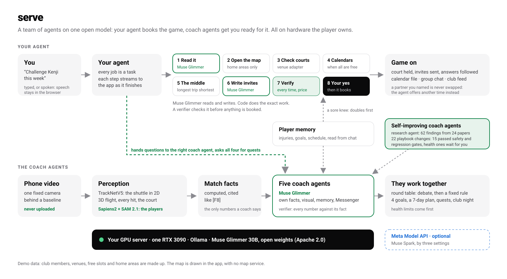

# Serve

**Play more. Manage less.**

**Say you want to play, and the agent does the rest.** It opens the map, lines up everyone's calendar, picks the
venue in the middle and sends the invites. Behind it is a private badminton coaching staff: one phone video goes in,
and out come the shuttle's 3D flight, shot speeds, heat zones, five coaches who explain them, and a weekly plan. The coaches are **Muse Glimmer**, Meta's open-weights
model, running on a GPU the player owns. Match footage and player memory never go to a cloud service.

Meta Global AI Developer Hackathon 2026 · Indie Developer track · Build for Your World



## Why

Let's be honest: we get lazy about training. Booking a court, finding people to play with and planning the week are
exactly the chores we skip. Elite players have analysts, multi-camera tracking and full-time coaches to do that for
them. Club and school players have a phone video and a guess. Many of them cannot send footage to the cloud either: it
shows minors, and teams keep their tactics private.

So Serve hands every chore to a team of agents: a 24-hour coaching staff in your pocket.

## What it does

Serve is a team of agents on one open model, Muse Glimmer:

- **Your agent.** It books games itself, and hands questions to the right coach agent.
- **Five coach agents.** Each has its own facts, visual and memory, and checks in on Facebook Messenger. They debate at a
  round table.
- **Self-improving coach agents.**
  - A research agent feeds the coaches' knowledge base: 62 findings from 24 papers so far.
  - Each night every coach proposes changes to its own playbook.
  - A change is adopted on its own only if it cites a finding, passes the safety rules and does not make the coach
    worse on its regression questions.
  - Health changes always wait for you, and any version can be rolled back.
  - So far 15 of 22 proposals were adopted. See `submission/evolution_report.md`.

- **Measures every shot.** From one fixed camera: the shuttle's flight in 3D, every hit, both players' positions, and
  launch speed, apex and landing for every shot.
- **Four coach agents and a head coach agent.** Each coach explains its findings on the visual it owns:
  - Tactics flashes the court zones that cost points.
  - Technique replays and grades every flight in 3D.
  - Fitness pulses the muscles to train on a 3D anatomy model.
  - Data profiles habits and patterns.

  Every coach can also be questioned in free chat.
- **A round table.** The staff debates the match against what it remembers about the player.
  - Conflicts are settled by a fixed rule: health limits from memory first, then points at stake, one owner per goal.
  - The output is four measurable goals and a 7-day plan, which is sent to the player in Messenger.
- **Courtside live view.** The score sits on the video, and a large between-point brief is written to be read in the
  20 seconds before the next serve.
- **A 24-hour coach in your pocket, in Facebook Messenger.** The round table's week arrives in Messenger. An hour
  before each session the coach sends a nudge with a meal from what is in your kitchen, and in the evening it checks
  in, logs what you did and adjusts tomorrow. Ask any coach anything there. It runs on the Messenger Platform
  (signed webhook, Send API, quick replies for 👍/👎), and reminders use the confirmed-event-update tag.
- **Auto highlights for Instagram and Facebook.** Ask your agent for a reel and it cuts one by itself.
  - *Picks.* The top five rallies from the labels: winners, rally length, smash finishes and pressure points.
  - *People.* YOLO finds both players in every frame. Meta's **Sapiens2** reads each player's pose and **SAM 2.1**
    cuts them out of the frame.
  - *The smash, in slow motion.* The replay goes back to the player's smash, ramps down to quarter speed while the
    camera pushes in on the smasher, holds on contact with a flash, then follows the shuttle to the floor.
  - *You, and how it is made.* What you post is you: your footage fills the top of the reel, with the smasher in a
    spotlight, and under it is Serve's view of the same moment, at the same camera angle: the players as
    their SAM 2.1 outlines with their Sapiens2 skeletons and the shuttle from racket to racket. A drawn-only reel,
    with no footage at all, is one tap away.
  - *Your own video.* Film a rally on your phone and pick it in the app. It goes to your own GPU server only, where
    Meta's **DETR** finds you, Sapiens2 reads your pose, SAM 2.1 cuts you out, and your fastest overhead swing is
    taken as your smash (`video/pose/reel.py`, streamed back step by step). The reel slows into the smash, lights
    you up, freezes on contact, and shows the path of your racket hand underneath.
  - *Posting.* Muse Glimmer writes the caption and every number in it is checked against the rallies. The phone's
    share sheet sends the video straight to Instagram or Facebook; on a computer the reel is saved, the caption copied
    and the site opened.
- **An agent, laid out like a social app.** The app opens on the agent, the way Meta's Muse app does: say what you
  want ("challenge Kenji to a singles match this week", "get this week's quests", "how should I warm up?").
  - *Tasks.* Every job is a card with its steps, streamed from the gateway as each one finishes. Jobs keep running
    while you move around the app, and the agent checks back when one needs you.
  - *Five tabs.* Agent, Club (a feed), Play, Goals and You. The coaches are the inbox, and the round table is the
    group chat. Coach and club stories sit at the top of the agent home.
  - *Light and dark.* The theme follows the system, and video and 3D stay dark in both.
- **Play: say you want to play, and the agent books it.**
  - *The problem.* Booking a court and lining up a time with friends is why most games never happen.
  - *Reading the request.* Muse Glimmer turns "doubles on Thursday evening with Hana", "challenge Kenji" or
    "我週六早上想打球" into a search.
  - *The map.* The agent opens the club map: the venues, and each member's home area (an area, never an address).
    The map is drawn in the app, so it works offline and no map service sees anyone's area.
  - *Everyone's calendar.* It lays everyone's free times side by side and finds the slots where all of them are free.
  - *The venue in the middle.* For each venue with a free court, it works out every player's trip and picks the venue
    where the longest trip is shortest. For example: Midtown, 17 minutes for you and 12 for Kenji. The routes and
    minutes are drawn on the map.
  - *Partners.* Without a name, it ranks members who are free on level, format, how far they live, and an attack
    that lands in the zone you lose most points in.
  - *Sparring.* Ask for "someone who plays like my next opponent" and the agent ranks members by how closely their
    shot mix matches the opponent's mix from your match. Example: Kenji, 91% style match, lifts and net shots.
  - *Challenges.* "Challenge Kenji" books singles at the fairest venue and sends a friendly challenge. If someone you
    named can't make it, the agent does not swap them for someone else; it offers the next time that suits you both.
  - *Health limits.* A knee limit puts doubles first.
  - *Invites.* Glimmer writes one invite per partner, in your voice and with their own trip time, and every time and
    price in it is checked against the booking.
  - *Booking.* Nothing is booked until you confirm. Then the agent holds the court and sends the invites. If someone
    can't make it, it invites the next best player.
  - *Game on.* You get a calendar file, a group-chat message, a warm-up from Coach Ren and +30 XP in the club league.
  - *From the feed.* An open game in the club feed has a Join button, and an open challenge a Challenge button that
    starts the agent.
- **The club: training as a game, played together.**
  - *Coach quests.* Each coach gives a weekly quest written by Muse Glimmer from the player's match and memory.
    Every number is checked, and a knee or ankle limit rules out jumps and split steps.
  - *The boss.* The next opponent is the boss. Each of its moves is a pattern that cost points, and every logged
    quest takes health off it.
  - *Rewards.* Streaks count recovery days, and badges include "Iron knee" for keeping every health limit.
  - *Leaderboard.* A club rating (Elo) that every reported challenge moves, with a podium, wins, effort and
    improvement boards, and your place and what a win would be worth.
  - *Best match.* Your agent ranks every member for a game this week. Code scores a fair game by rating (a win
    chance near 50%), a shared free time, the trip to the venue in the middle, training value (their attack lands
    where you lose points, or they play like your next opponent), format, health limits and history. Muse Glimmer
    says why, and every number in it is checked.
  - *Agent to agent.* Your agent then talks to that member's agent. Each side is Muse Glimmer: yours from your
    calendar and the courts, theirs from what the member shares with their agent (free times, preferences, limits).
    They propose, counter and agree, and code checks every time either side names against both calendars and the
    court timetable. The agreed game is booked only when you say yes, and the other agent has already said yes.
  - *Challenges.* Challenges members sent you (accept or decline), open challenges on the board, a random match
    drawn fairly from the members free when you are, and results you report, which move both players' ratings and
    post to the feed. Badges include "Giant killer" for beating someone rated 100 above you.
  - *Club night.* The head coach plans one session for all 12 members on 3 courts. Code builds the groups so nobody
    waits and shared health limits hold. Glimmer writes every group's drill and reason, and they are checked like
    any reply.
  - *Feed and sharing.* Cheers, coach replies, and sharing to WhatsApp and Threads.
  - *Privacy.* The player chooses what the club sees, and footage, chats and memory are never shared.

## How it uses Meta AI

| Model | Where | Role |
|---|---|---|
| **Muse Glimmer** (open weights, 30B) | Own GPU server: Ollama on one RTX 3090 | Every agent: your agent (it reads play requests, hands questions to the coaches, writes invites, explains your best match and negotiates with other members' agents), the members' agents, the five coach agents (in the app and in Messenger), the research agent; also memory extraction from chat, weekly quests, the club night plan and highlight captions |
| **Sapiens2** (pose, 0.4B, open) | Own GPU server, Hugging Face Transformers | Both players' pose (body, feet, hands) on every highlight frame: the skeletons in the drawn reel, the racket hand that the shuttle leaves from, the camera's aim at the smasher |
| **SAM 2.1** (Hiera-L, open) | Own GPU server, Hugging Face Transformers | Each player's outline from their box: the silhouettes in the reel's view of the rally and the spotlight on the smasher in the footage |
| **DETR** (ResNet-50, open) | Own GPU server, Hugging Face Transformers | Finds you and the other player in a video you film yourself, the boxes Sapiens2 and SAM 2.1 start from |
| SAM 3.1 | Planned (access requested) | Text-prompted player tracking, so uploaded videos become analysable; automatic court calibration; blurring bystanders before sharing |
| Muse Spark / Muse Image (Meta Model API) | Planned | Agentic head coach with tool calls; consistent coach portraits and share cards |

Meta platforms: **Facebook Messenger** (the coaches in your pocket, Messenger Platform webhook and Send API),
**Instagram** and **Facebook** (highlight reels through the share sheet).

Glimmer is used as more than a chat box:

1. **Grounded.** Each coach sees only the facts in its own area, from a facts sheet computed from the match. It must cite them, as in "14 net errors [F4]".
2. **Verified.** A second pass checks every number against the fact cited in the same sentence. A reply that fails is rewritten once, then replaced by the raw fact. Small counts for drills are allowed; match figures used as training doses are not.
3. **Remembers.** Glimmer extracts durable facts from chat (injuries, goals, schedule) into player memory. Every coach retrieves that memory before it answers.
4. **Adapts to health.** A knee or ankle report changes the plan: jump drills are swapped for low-impact versions, and the round table defers plyometrics.

Measured on our server: In an 18-question test across all five coaches (4 in Traditional Chinese), every reply was answered by the model with all of its numbers verified (115 numbers in total); 83% passed on the first try and the rest after one rewrite. Median reply time was 22 s on one RTX 3090 (about 28 tokens/s). Report: [submission/glimmer_eval.md](submission/glimmer_eval.md).

## Repository layout

| Path | Content |
|---|---|
| `web/` | React + Three.js + Vite app; layouts for laptop, tablet and phone |
| `agent/` | Node gateway: coach chat, number verifier, player memory, round-table delivery, Messenger webhook, highlight captions, best match and agent-to-agent scheduling (`match.js`), reels from your own video (`reel.js`), research agent |
| `server/start.sh`, `watch.sh`, `up.sh` | Start Muse Glimmer (Ollama, GPU 1, port 11435) and the gateway (port 8790) on the GPU server; `up.sh` starts a watchdog that restarts them |
| `video/` | The demo video pipeline (recording, narration, assembly) and `video/pose/`: player detection (YOLO), Sapiens2 pose and SAM 2.1 outlines for the highlight clips, and `reel.py` for a player's own video (DETR, Sapiens2, SAM 2.1) |
| `docs/` | Design notes and the demo video script |
| `submission/` | Project description, architecture diagram, cover and screenshots, the Glimmer evaluation and the self-improvement report |

## Run

On the GPU server (Linux, NVIDIA GPU with 24 GB):

```bash
ollama pull muse-glimmer            # Meta's open-weights model, about 17 GB at Q4
ollama pull qwen3-embedding:0.6b    # vector search over the research findings (EMBED_URL)
~/shuttlecoach-meta/up.sh           # watchdog: keeps Ollama on :11435 and the coach gateway on :8790 running
```

On your machine:

```bash
cd web
npm install
npm run dev                         # http://127.0.0.1:5191
```

`web/.env.local` sets `VITE_AGENT_URL` to the gateway. To run the coaches on Muse Spark through the Meta Model API
instead, set `LLM_URL=https://api.meta.ai/v1`, `LLM_MODEL=muse-spark-1.3` and `MODEL_API_KEY` for the gateway.

## Not in this repository

These are not ours to publish, or are derived from material that is not:

- **The sample match.** A professional broadcast match used during development: its video, its shot labels and the
  data derived from them (`web/public/data/` other than the demo club and venues, `web/public/media/`).
- **The highlight pose data** (`web/public/data/highlight_people.json`), read from that footage by `video/pose/`.
- **The 3D anatomy model files** (`web/public/body/`) and the Whisper model files (`web/public/models/`).

The pages built on the match (the analysis, the coaches, the highlights) need these files to run. The agent, Play and
the club use the demo data that is included.

## Prototype status

- Uploaded videos are opened locally, but the analysis shows a precomputed sample match. SAM 3.1 player tracking is
  the step that makes new videos analysable.
- Coach briefings on the coach pages are templated from the match facts. Free chat, the Messenger coaches and memory
  extraction run live on Muse Glimmer.
- Shuttle speeds are estimates from the reconstructed 3D track. The body view is a coaching heuristic, not medical advice.

## Credits

- 2D shuttle tracking: [TrackNetV5](https://github.com/gino6178/TrackNetV5).
- Pose and outlines for the highlights: [Sapiens2](https://huggingface.co/facebook/sapiens2-pose-0.4b) (Meta,
  Sapiens2 License), [SAM 2.1](https://huggingface.co/facebook/sam2.1-hiera-large) (Meta, Apache 2.0) and
  [DETR](https://huggingface.co/facebook/detr-resnet-50) (Meta, Apache 2.0), through
  Hugging Face Transformers (Apache 2.0). Player boxes: [YOLO11 pose](https://github.com/ultralytics/ultralytics)
  (Ultralytics, AGPL-3.0), run on our server only.
- 3D anatomy: BodyParts3D 4.0, © The Database Center for Life Science, CC BY 4.0, adapted via
  [Human Atlas](https://github.com/ashemag/human-atlas) (MIT).
- Coach portraits are AI-generated images of fictional people.
- Voice: Whisper tiny (Xenova ONNX), in the browser.
- Fonts: Michroma, Manrope, IBM Plex Mono.
